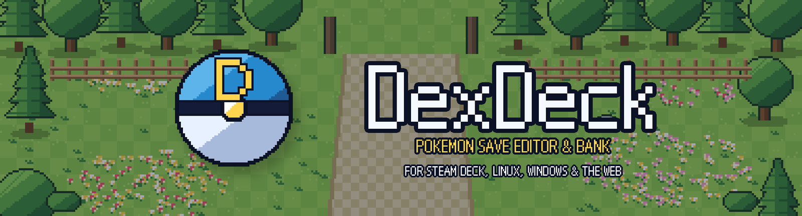
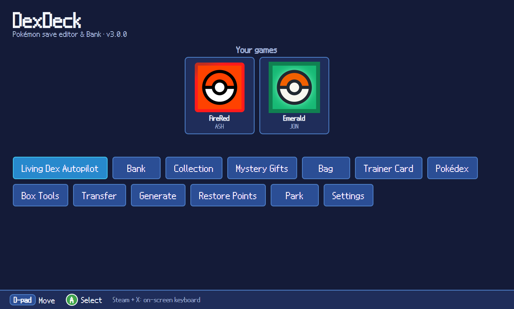
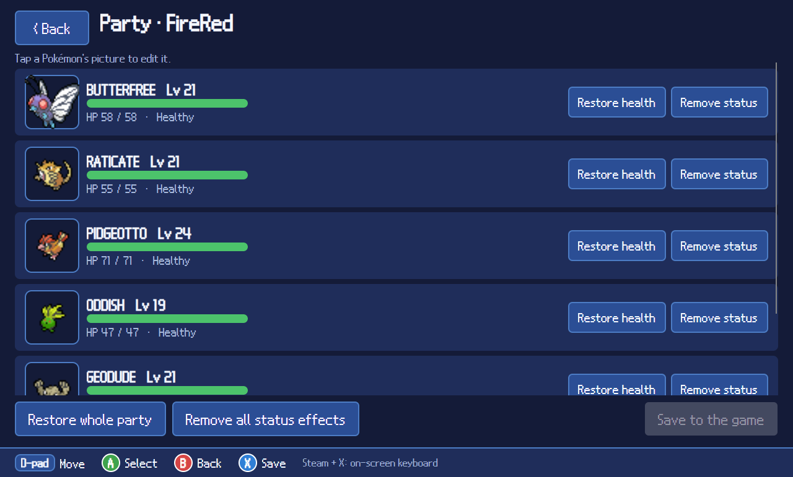
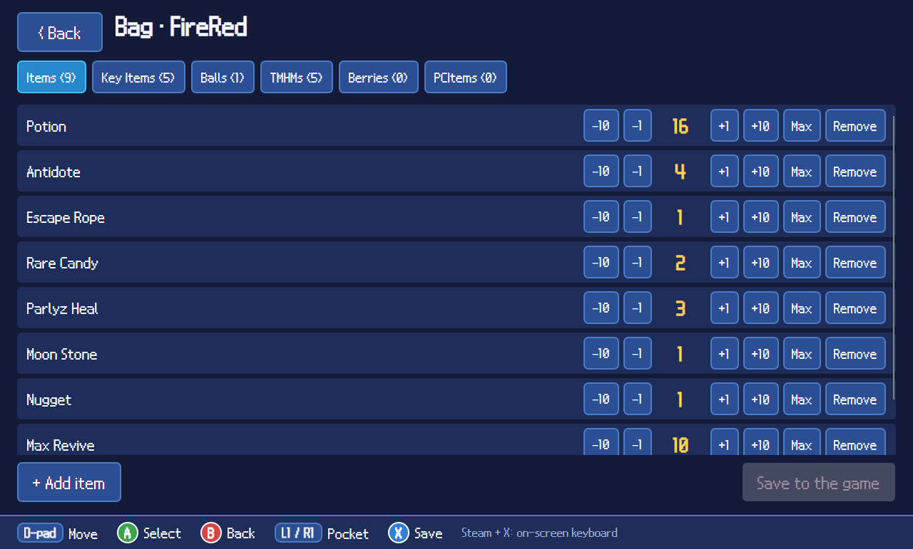
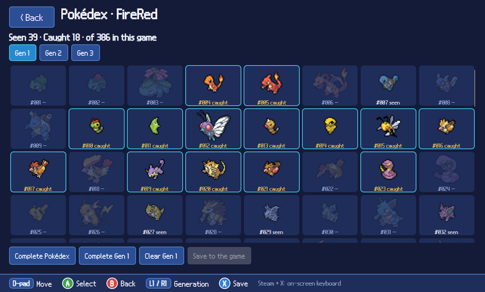
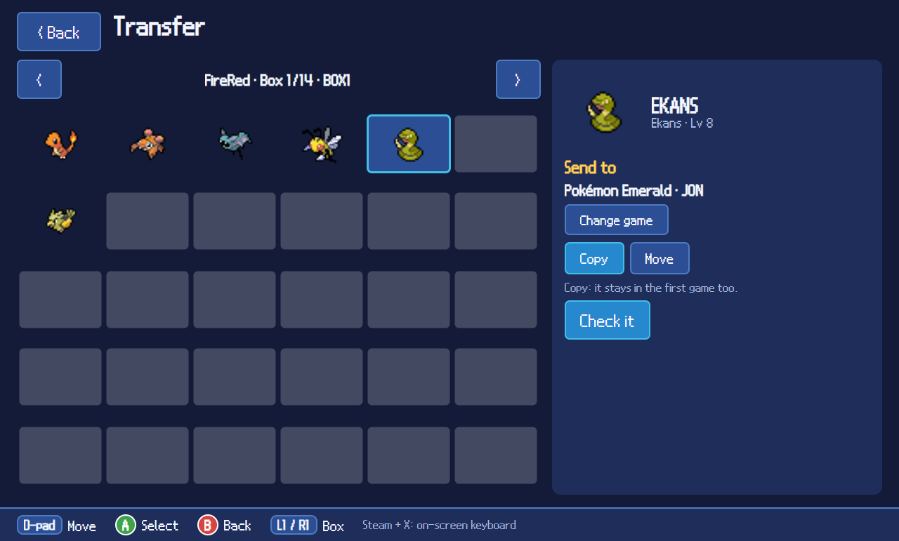
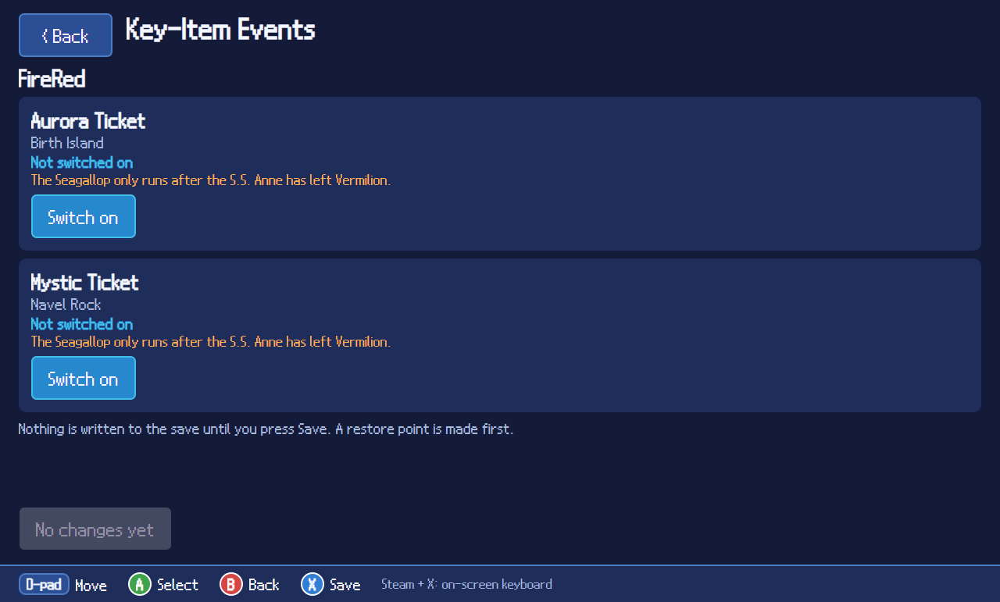
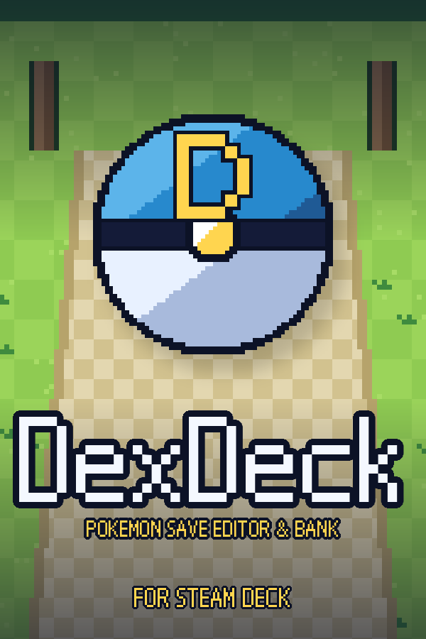
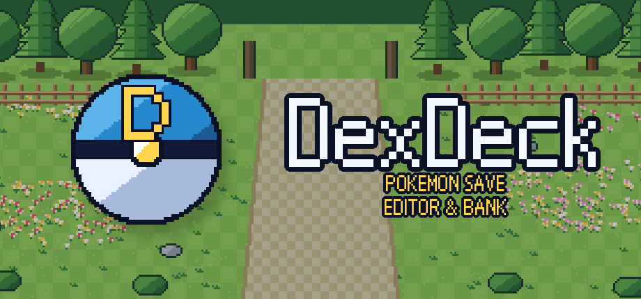

  
  
  
  
  

<b>A Pokémon save editor and Bank for the Steam Deck, Linux, Windows and the web. Controller first, touch friendly.</b>

---

> [!IMPORTANT]
> **DexDeck is an unofficial, independent project. It is not PKForge and it is not made by the PKForge team.**
> Its save-handling code started from the open-source Android app
> [PKForge by sofianeelhor](https://github.com/sofianeelhor/PKForge) (GPLv3), and it is credited below. The original
> author has **no affiliation** with DexDeck, has not reviewed it, and does not support it. **Please do not ask the
> PKForge developer or the PKForge Discord for help with DexDeck.**

> [!WARNING]
> **100% of the code in DexDeck's interface was written by AI.**
> The person running this repository has no programming background. Every screen, the build scripts and this page were
> generated by an AI assistant (Anthropic's Claude) from plain-English instructions, then built by GitHub Actions and
> tested by hand on one Steam Deck and a Windows PC. See [How this was made](#how-this-was-made) and
> [Honest limitations](#honest-limitations) before you trust it with a save you care about.

## What is this?

DexDeck is a save editor and cross-generation Bank for Pokémon games, designed for a handheld first: big buttons,
D-pad navigation and an on-screen hint bar, with touch and mouse working everywhere. It runs on the Steam Deck and
other Linux machines (including from Gaming Mode), on Windows, and in a web browser.

It edits saves from the emulators you already use (for example the ones EmuDeck installs). Under the hood it reuses the
open-source engine of PKForge, an Android app that had no Linux version, together with PKHeX. DexDeck's own interface
is new and separate.

## Try it in your browser

**<https://jlaws11.github.io/DexDeck/>**

The web version runs entirely inside your browser, and your saves never leave your device. Tap **Upload saves**, edit,
then use **Download saves** to get the edited file back. Your Bank and restore points are remembered in the browser,
so use **Bank → Import / Export** to keep a backup copy. It is the newest version and the least tested, and the
controller does not work there yet.

## Screenshots

  
  

  
  

  
  

*Screenshots are taken on a Steam Deck. The bar along the bottom always shows what each button does.*

## What is original and what is not

| Part | Where it comes from |
| --- | --- |
| Save reading and writing, legality, Bank, backups, Mystery Gift database, Living Dex logic | **PKForge's open-source engine**, reused with a few small additions (see below) |
| Pokémon data and save formats | **[PKHeX](https://github.com/kwsch/PKHeX)** by kwsch and contributors |
| Legalizing and generating Pokémon | **[Auto Legality Mod](https://github.com/santacrab2/PKHeX-Plugins)** by santacrab2 and contributors, via PKForge |
| The DexDeck user interface (every screen, the controller support, the Park, themes) and the web version | **Written by AI** for DexDeck |
| Park backdrop pixel art | **Generated by AI** (drawn by a script, not copied from any game) |
| Game cover art, UI font, Pokémon sprites, navy colour scheme | From the original PKForge and PKHeX resources, under their own licences and attribution notes (see Credits) |

The original Android app is **not** included, copied or redistributed as a product. Only its engine code is reused,
as its licence allows, and DexDeck stays under the same GPLv3 licence.

## Features

Everything below exists in DexDeck and has been built, though see the limitations section for how much of it has
actually been tested.

- **Saves list with cover-art thumbnails.** Point it at the folders your emulators use and it finds your saves. Folders
  and scanning live under **Settings**, along with UI Themes and a Controller Test screen.
- **Pokémon editor.** Tabs for Info, Moves, IVs, EVs and Current condition (heal, cure status), with type plates and
  a live legality check. Copy a Pokémon out as a Showdown set.
- **Collection.** A grid of every Pokémon you own across all games and the Bank. Edit any copy directly, including
  ones sitting in a save or the party. Tap a missing species to generate it.
- **Bank.** A cross-game Bank for storing Pokémon outside any game file.
- **Import / Export (in the Bank).** Bring in a **PKSM** bank (`.bnk` with its `.json`), a PKSM dumps `.zip` or loose
  **PKHeX** `.pk*` files or folders, with a preview first. Export the Bank as a folder of PKHeX files or as a PKSM bank.
- **Transfer.** Move or copy a Pokémon between two saves side by side, with a conversion preview.
- **Save hub.** Tap a save's thumbnail for Box, Collection, Party, Bag, Trainer Card and Pokédex.
- **Party.** See your party's health and status, restore health, remove status effects, or tap a sprite to edit it.
- **Living Dex Autopilot.** Plans a living dex from what you already own. DexDeck adds a **Move or Copy** choice,
  so you can copy into the Bank and keep the originals in your game.
- **Mystery Gifts.** Browse the bundled event database and send gifts to the Bank or into a save.
- **Bag editor, Trainer Card, Pokédex editor.** The Trainer Card shows your in-game character and lets you use a custom picture.
- **Box Tools.** Sort, swap and clear boxes, set everything shiny, heal, and find duplicates.
- **Generate Pokémon.** Build a legal Pokémon from scratch (species, level, nature, shiny, form), or paste Showdown sets.
  Send it to the Bank or into the game.
- **Showdown import and export.**
- **Restore Points.** Every write makes a restore point first. Roll any save back from a list.
- **The Park.** A small mini-game where Pokémon from your collection wander a pixel-art park, chat to each other, and
  can be petted and fed. It is purely cosmetic and **never changes your save files**.
- **UI Themes.** Eight colour themes, remembered between launches.
- **Credits & License** screen in Settings.
- **Controller support.** Everything works with the Steam Deck's D-pad and buttons, with an on-screen hint bar showing
  what each button does. Touch also works.

### How your saves are protected

These protections come from PKForge's engine and were kept:

- A **restore point is made before every write**.
- Saves are written **atomically**, so a crash mid-write cannot leave half a file.
- The app **refuses to write if the file changed on disk** since it opened it, for example because an emulator is
  still running.
- ROM-hack saves are not opened for writing.
- Nothing changes until you tap **Save**.

**Even so: always keep your own backups of saves you care about. Close your emulator before editing.**

### Not in DexDeck (yet, maybe never)

Compared with PKForge on Android, these are **not** implemented:
RNG tools, the Poképark (replaced by the simpler Park), Nuzlocke report, encounter browser, QR code and live PKSM-to-3DS transfer (PKSM bank files can be imported and exported, see above),
Hardcore mode, item Mystery Gift cards, game-specific editors (event flags, daycare, roamers, honey trees, Poké Beans,
Grand Underground and similar), hex editor, box wallpapers, music, dual-screen support, and ROM-hack editing. This list
may be incomplete. If PKForge has it and it is not in the features list above, assume DexDeck does not.

## Supported games and emulators

The engine underneath handles saves from Gen 1 to Gen 9. **In practice DexDeck has only been tested with a small
number of saves** (see below), so treat everything else as "should work, unproven."

Folder types offered in Settings are aimed at the emulators installed by EmuDeck, such as **RetroArch** (Game Boy,
GBA, DS) and **Azahar** (3DS). You can also point it at any folder that contains saves.

## Download and install

Go to **[Releases](../../releases/latest)** and open the newest "DexDeck" entry. Each release has two downloads:

| You use | Download |
| --- | --- |
| Steam Deck or Linux | `DexDeck-x86_64.AppImage` |
| Windows 10 / 11 (64-bit) | `DexDeck-windows-x64.zip` |

### Steam Deck / Linux

1. Download the AppImage (in Desktop Mode, use the browser).
2. Right-click it, **Properties → Permissions**, and tick **Allow executing as program**.
3. Double-click to run. To launch it from Gaming Mode, right-click it and **Add to Steam**
   (see [Add it to Steam](#add-it-to-steam-artwork-included)).

### Windows

1. Download the zip and **extract all** into a folder (do not run it from inside the zip).
2. Open the folder and run **`DexDeck.exe`**. Nothing needs installing.
3. If Windows SmartScreen warns about an unknown publisher, choose **More info → Run anyway**. The app is not
   code-signed. You can read the source code in this repository and build it yourself if you prefer.

The Windows and web versions are newer and less tested than the Steam Deck one. If it closes unexpectedly, a note is written to
`%LOCALAPPDATA%\DexDeck\crash.log`, which is helpful to include in a bug report.

## Using it

1. Open **Settings → Folders** and add the folder(s) that hold your saves. On the Deck, EmuDeck's RetroArch and Azahar
   folders are suggested. On Windows, common emulator folders are suggested. Press **Back** to return home.
2. Your games appear under **Your games**. Tap a thumbnail to open its hub (Box, Collection, Party, Bag, Trainer Card,
   Pokédex), or use the buttons on the home screen (Bank, Living Dex Autopilot, Transfer and so on).
3. Edit things in memory, then press **Save**. A restore point is made first, so you can undo from **Restore Points**.
4. **Close your emulator before editing** a save, and keep your own backups too.

**Controls (Steam Deck):** D-pad moves, **A** selects, **B** goes back, **X / Y** are shown in the bottom hint bar
where they do something, and **L1 / R1** change page, box or tab. In the Pokémon editor, L1 / R1 switch tabs while the
tab row is highlighted. Touch and mouse work everywhere too.

**Where your data lives:** the Bank, restore points and settings are in `~/.local/share/DexDeck` on Linux and
`%LOCALAPPDATA%\DexDeck` on Windows. Copy that folder to back up or move your Bank. (Earlier builds used a
`PKForge` folder; DexDeck copies it across the first time it starts.)

**Moving a PKSM or PKHeX Bank in or out:** open **Bank → Import / Export**. Pick a file or folder with the built-in
browser (it has shortcuts for Downloads and SD cards / USB sticks), check the preview, then confirm.

Made for the Steam Deck's 1280×800 screen. Downloads are for Linux x86-64 and Windows x64 only; there are no macOS or ARM builds, but the web version runs in any modern browser. Some screens are not yet laid out for a phone-sized screen.

## Add it to Steam (artwork included)

You can run DexDeck from Gaming Mode by adding it as a non-Steam game. A matching set of artwork (cover, banner,
logo, capsule and icon at Steam's sizes) is attached to the releases as **`dexdeck-steam-art.zip`**.

  
  &nbsp;&nbsp;
  

1. In Desktop Mode, right-click the AppImage and add it to Steam, or use Steam's **Add a Non-Steam Game**.
2. In Gaming Mode, open its page, tap the cog, then **Manage**, then **Set custom artwork**, and pick the images.
3. The default controller layout works. If buttons ever seem dead, open **Settings → Controller Test** to see what the
   Deck is sending, and include a photo of it when you report the problem.

## How this was made

Transparency matters here, so exactly how:

- The project owner gave plain-English instructions (for example, "add a bag editor", "make it controller friendly").
- An AI assistant (Claude, by Anthropic) wrote all of the new code and the build setup.
- The AI **could not compile or run the program itself.** The owner uploaded the code to GitHub, where an automated
  build (GitHub Actions) compiled it, then pasted any build errors back to the AI to fix. The result was then tried
  by hand on a Steam Deck, a Windows PC and a phone browser.
- No human has reviewed the code line by line. There is no automated test suite for the Linux interface.

## Honest limitations

- **Tested mainly on one Steam Deck, with a quick pass on Windows,** by one person, with a handful of saves, mainly a Game Boy Advance game
  (FireRed) and a 3DS save. Other games, other emulators and other machines are untested.
- **AI-written code can contain bugs**, including ones that only show up with certain saves. Several screens were
  added very recently and may crash or misbehave.
- Please **keep backups** and treat this as beta software.
- Bugs are fixed on a best-effort basis by the same AI-assisted process. There is no support team.

## Reporting problems

Open an **Issue in this repository**. Include which game, which emulator, what you tapped and any error message.
**Do not report DexDeck problems to the original PKForge project.**

## Credits and licence

DexDeck is licensed under the **GNU General Public License v3 or later**, inherited from PKForge and PKHeX.Core, and
is a derivative of PKForge. Credits below are carried over from the original project, because DexDeck reuses its
engine, data and some of its art. Full attribution notes sit in the original project's `ATTRIBUTION.md` files.

- **[PKForge](https://github.com/sofianeelhor/PKForge)** by sofianeelhor: the open-source app whose engine DexDeck is built on
- **[PKHeX](https://github.com/kwsch/PKHeX)** by Kaphotics and every contributor over the years, the engine everything runs on
- **[PKHeX-Plugins / Auto Legality Mod](https://github.com/santacrab2/PKHeX-Plugins)**, the offline legalizer
- **[spritedmistery](https://www.instagram.com/spritedmistery/)**: the original PKForge's look, colour schemes, logos and buttons, which DexDeck's navy theme is styled after
- **[PKSM](https://github.com/FlagBrew/PKSM)**: the pixel chrome the original UI builds on (GPL-3)
- **[SteamGridDB](https://www.steamgriddb.com)**: game cover art and cartridge icons (community submissions)
- **[Pokémon Showdown](https://pokemonshowdown.com)** by [Smogon](https://www.smogon.com) and its sprite artists: Pokémon sprites
- **[Avalonia UI](https://avaloniaui.net/)**: the cross-platform interface toolkit DexDeck is built with
- **NDS12** pixel font by [Caveras](http://fontstruct.com/fontstructors/caveras) (CC BY-NC-SA 3.0), used in the app and in the artwork text, so this project is non-commercial

Not reused here, but credited by the original for its Android-only features: AlchemyBats (Poképark tileset), PMDCollab
SpriteCollab, PokeAPI, game-icons.net and Bulbagarden Archives.

Sprites and Pokémon names © Nintendo, Creatures Inc., GAME FREAK inc. Pokémon and all related names are trademarks of
their owners. This project is not affiliated with or endorsed by Nintendo, Game Freak or The Pokémon Company. No game
ROMs or saves are included or provided.

## Links to the original PKForge (not affiliated with DexDeck)

These links go to the **original, separate project**. They are provided for credit and so you can use the real thing
on Android. The PKForge team does not know about, endorse or support DexDeck.

- Original repository: <https://github.com/sofianeelhor/PKForge>
- Original downloads (Android APK): <https://github.com/sofianeelhor/PKForge/releases>
- Original manual (wiki): <https://github.com/sofianeelhor/PKForge/wiki>
- Original Discord, for the **Android app only**: <https://discord.gg/bMtzZmTDfu>

Per the original project's own warning, `pkforgeapp.com` is **not** an official PKForge site. Do not download anything
from it.
